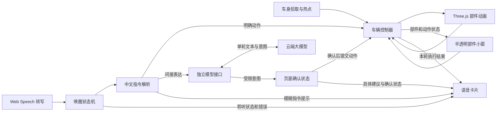

# 3D 仿真车模 Demo 落地方案与项目架构

| 项目 | 内容 |
| --- | --- |
| 文档版本 | v1.2（对齐项目脚手架与分支边界） |
| 日期 | 2026-11-04 |
| 需求基线 | [3D 仿真车模交互 Demo 需求文档 v1.3](./3D仿真车模交互Demo需求文档.md) |
| 技术路线 | 独立项目复用 FormDrive 的 Tesla Model 3 资产和部件动画逻辑 |
| 界面基线 | 全屏暗棚展厅、车身热点、半透明部件小窗、独立语音卡片 |
| 发布目标 | GitHub Pages 项目站点与独立 HTTPS 模型接口，桌面 Chrome、Edge 为正式验收环境 |

## 1. 技术选型与复用边界

| 层级 | 选型 | 职责 |
| --- | --- | --- |
| 页面与构建 | Vite、React、TypeScript | 单页布局、控制小窗、加载与反馈、静态打包 |
| 3D 场景 | React Three Fiber、Three.js `WebGLRenderer` | 场景组织、车模加载、渲染循环、光照和阴影 |
| 车辆动画 | Three.js 节点变换、`MathUtils.damp`、R3F `useFrame` | 四门旋转、四窗升降、前后备箱开合 |
| 观察与点击 | Three.js `OrbitControls`、射线拾取 | 拖拽、缩放、部件命中与热点定位 |
| 语音 | Web Speech API、浏览器端中文指令规则 | 转写、唤醒、指令解析、播报和确认 |
| 模型接口 | 独立部署的 HTTPS Serverless 函数 | 接收单轮转写，调用云端模型，返回受限意图 |
| 发布 | GitHub Actions、GitHub Pages、Serverless 运行环境 | 静态站点和模型接口分别部署，GLB 随站点同源提供 |

锁定 FormDrive 上游提交 `e2f861630035385adacd1c5fcdeae5258557cce6` 作为首版复用基准。复用该提交的 `tesla-model-3-2018.glb`、`studioConfig.js` 中 Tesla 的部件参数，以及 `VehicleModel.jsx` 中的节点匹配、原始变换保存和窗玻璃遮罩逻辑。相机、光照、点击交互、悬浮小窗、车辆控制器和语音模块按本 Demo 组织。[上游版本](https://github.com/nesdesignco/FormDrive/tree/e2f861630035385adacd1c5fcdeae5258557cce6) · [部件配置](https://github.com/nesdesignco/FormDrive/blob/e2f861630035385adacd1c5fcdeae5258557cce6/src/config/studioConfig.js) · [车辆动画](https://github.com/nesdesignco/FormDrive/blob/e2f861630035385adacd1c5fcdeae5258557cce6/src/components/scene/VehicleModel.jsx)

已读取 GLB 元数据。文件为 glTF 2.0，约 **22.7 MB**，动画轨道数为 **0**，未声明必需压缩扩展。首版使用原始文件，通过 `GLTFLoader` 加载并以代码驱动动画。发布时保留模型作者 Ameer Studio、原始来源和 CC BY 4.0 许可链接，资产修改时记录改动。移植上游源码时保留对应 MIT 许可声明。[GLB 文件](https://github.com/nesdesignco/FormDrive/blob/e2f861630035385adacd1c5fcdeae5258557cce6/public/models/tesla-model-3-2018.glb) · [车模归属](https://github.com/nesdesignco/FormDrive/blob/e2f861630035385adacd1c5fcdeae5258557cce6/public/models/TESLA-LICENSE.md) · [上游源码许可](https://github.com/nesdesignco/FormDrive/blob/e2f861630035385adacd1c5fcdeae5258557cce6/LICENSE) · [CC BY 4.0](https://creativecommons.org/licenses/by/4.0/)

## 2. 模块划分与数据流



目标目录结构如下。公共契约已放入脚手架，各功能路径的分工见[模块拆分与并行开发](./3DCar模块拆分与并行开发.md)。

```text
3DCar/
├─ index.html
├─ package.json
├─ package-lock.json
├─ vite.config.ts
├─ public/models/
│  ├─ tesla-model-3-2018.glb
│  └─ TESLA-LICENSE.md
├─ src/
│  ├─ main.tsx
│  ├─ App.tsx
│  ├─ contracts/vehicle.ts   # 车辆、场景和语音共用的契约
│  ├─ scene/
│  │  ├─ Showroom.tsx          # 画布、相机、灯光、地面
│  │  ├─ TeslaModel.tsx        # GLB 加载、节点绑定、逐帧更新
│  │  ├─ PartHotspots.tsx      # 点击拾取与车身热点投影
│  │  └─ model3Parts.ts        # 部件节点、动作参数、热点锚点
│  ├─ vehicle/
│  │  └─ vehicleController.ts # 命令队列、目标状态、动作结果
│  ├─ voice/
│  │  ├─ useVoiceControl.ts   # 识别会话、唤醒、播报与确认状态
│  │  ├─ parseCommand.ts      # 本地指令解析与路由判定
│  │  └─ intentClient.ts      # 请求独立接口、校验结果、处理超时
│  └─ ui/
│     ├─ PartPanel.tsx
│     ├─ VoicePanel.tsx
│     └─ showroom.css
├─ shared/intent.ts            # 前后端共用的模型接口契约
├─ server/                     # 模型接口，独立部署
│  └─ intent.ts                # 请求校验、限流与模型调用
└─ .github/workflows/pages.yml
```

**车辆控制器是界面状态的唯一来源。** 小窗和热点发送切换动作，语音发送明确的目标状态。控制器维护部件的稳定状态、目标状态和执行状态，场景负责每帧更新姿态，到位后回传完成。React 只接收执行开始、到位或失败等状态变化。

同一部件的请求由控制器串行处理。动画期间，手动入口显示「执行中」并暂时禁用，其他部件仍可操作。语音批次按文本顺序逐条执行，每条动作完成后再推进。一次「关闭所有车窗」属于一条动作，组内四扇窗可同时升起，全部到位才进入下一条。已到目标状态的指令直接反馈「已打开」或「已关闭」。

## 3. 车辆场景与部件动画

### 3.1 节点绑定

| 部件 | GLB 节点 | 动画依据 |
| --- | --- | --- |
| 左前门、左后门 | `door_lf_dummy`、`door_lr_dummy` | 绕各自局部 Z 轴，开启角分别为 −1.08、−1.02 rad |
| 右前门、右后门 | `door_rf_dummy`、`door_rr_dummy` | 绕各自局部 Z 轴，开启角分别为 +1.08、+1.02 rad |
| 左前窗、左后窗 | `door_lf_glass.0_0`、`door_lr_glass.0_0` | 按上游行程和玻璃包围盒计算下降距离 |
| 右前窗、右后窗 | `door_rf_glass.0_0`、`door_rr_glass.0_0` | 按上游行程和玻璃包围盒计算下降距离 |
| 前备箱、后备箱 | `bonnet_dummy`、`boot_dummy` | 绕各自局部 X 轴，开启角分别为 +0.58、−0.82 rad |

加载后校验 10 个节点是否能唯一匹配。按 GLB 原始名称及 Three.js 加载后的规范化名称定位，保留父子层级。以加载时的局部变换为闭合基准；门和箱盖在基准角上加开启量，窗玻璃的下降方向换算到车门局部空间。车门打开时，玻璃仍随门移动并可独立升降。[上游节点定义与行程](https://github.com/nesdesignco/FormDrive/blob/e2f861630035385adacd1c5fcdeae5258557cce6/src/config/studioConfig.js) · [GLTFLoader 文档](https://threejs.org/docs/pages/GLTFLoader.html)

每帧按实际时间差做阻尼插值，在进入误差阈值时将变换落到精确目标，再通知控制器动作完成。车窗下沉时同步处理玻璃显隐和透明材质，避免玻璃从门板穿出。引擎指令直接更新模拟运行状态并提供文案反馈。

### 3.2 观察、拾取与小窗

- `OrbitControls` 处理左键拖转和滚轮缩放，限制缩放距离和俯仰范围。记录按下期间指针离起点的最大位移，超过阈值即判为拖拽，轻点才进入拾取。[OrbitControls](https://threejs.org/docs/pages/OrbitControls.html)
- 射线取车模最近的可见表面，将命中的门板、玻璃或箱盖子网格映射到部件 ID。若最前方是不可交互的车身表面，结束拾取。热点以车身上的局部锚点投影到屏幕，遮挡时隐藏。[Raycaster](https://threejs.org/docs/pages/Raycaster.html)
- 车窗热点放在跟随车门的窗框位置，玻璃完全降下后依旧可点击。箱盖热点可随可见箱盖移动。右侧小窗按车门、车窗和备箱分组，始终提供对应部件的按钮与状态。四窗按方位排成 2×2，提供「全部降下」「全部升起」。
- 暗棚背景由 3D 画布铺满。用环境反射塑造银色车漆，用主光、轮廓光和地面阴影建立车身层次。小窗和语音卡片用 HTML/CSS 叠加在画布之上，控件区域接收点击，周围透明区域可拖动车模。[Three.js 环境光照](https://threejs.org/docs/pages/RoomEnvironment.html)

## 4. 语音状态机与指令执行

### 4.1 唤醒和本地规则

1. **开启。** 用户点击「开启语音」后启动 `SpeechRecognition`，兼容 `webkitSpeechRecognition`，识别语言为 `zh-CN`。默认显示「语音未开启」。实际开始识别后，显示「等待唤醒」。
2. **唤醒。** 对转写做空白和标点归一化，在等待状态下匹配固定词「小满小满」。同段有指令时保留唤醒词之后的内容。单独唤醒时进入「聆听指令」，给用户 5 秒开始说话。权限、浏览器或在线识别服务异常时，在语音卡片上给出相应提示。
3. **收集。** 暂定用约 1 秒静默作为一轮的收尾窗口，最终值用真实试说调校。浏览器若把一轮话语分成多个识别结果，按结果序号追加已确认片段。语音开始事件或含指令的中间结果可确认用户已开始说话，动作只由本轮最终文本产生。5 秒限制的是开始说指令的时间，收尾窗口负责等待后续分句。
4. **判定与执行。** 用白名单匹配动作、部件、方位和连接词，返回有序动作与提示。共享动作只在连接关系和后续目标都明确时继承。明确命令、多指令和已知缺参表达由本地处理，例如「打开左前门，再打开」执行第一项并提示第二项缺少对象。其余适合判定间接意图的完整表达进入 §4.2。
5. **结束或恢复。** 执行完成、指令未识别或超时后，展示结果并回到等待唤醒。识别会话自然结束时，仅在用户仍开启语音且允许恢复的状态下重新开始。关闭语音时取消识别和本轮收集，丢弃过期回调，并撤销尚未下发的语音动作。权限、网络或识别服务错误时显示相应提示，手动控车可独立使用。[Web Speech API 规范](https://webaudio.github.io/web-speech-api/)

### 4.2 大模型建议与一次确认

1. **识别意图。** 发起模型请求时，语音卡片显示「正在理解」。请求只包含唤醒后的本轮最终转写文本。明确指令、已知缺参、含已匹配动作的多指令及取消表达在本地结束。接口超时、失败或返回 `unsupported` 时，提示用户改说具体指令并结束本轮。
2. **生成建议。** 收到 `ventilate` 时，从当前已升起的车窗中选择一扇，优先左前窗，其余按右前、左后、右后顺序选择。页面保存待确认动作，并用目标名称生成追问。四窗均已降下时直接反馈并结束本轮。模型结果通过枚举校验后才参与建议生成。
3. **播报与确认。** 页面显示追问并通过 `SpeechSynthesis` 播报。播报前暂停语音识别并抑制自动重启，播报结束后恢复识别并启动 5 秒确认窗口。播报不可用时，卡片展示提示后直接开始确认。确认状态只接受本轮的「需要」「不用」等明确答复。[Web Speech API 规范](https://webaudio.github.io/web-speech-api/)
4. **执行或撤销。** 收到确认后，消费一次待确认动作并通过车辆控制器设置车窗为降下，反馈动画结果。取消、超时、关闭语音或重新唤醒时清除旧建议。请求与建议都关联当前语音轮次；退出本轮时中止请求并忽略迟到的模型或语音回调。

## 5. 独立模型接口与部署边界

GitHub Pages 发布车模与前端。前端用 `VITE_INTENT_API_URL` 配置独立 HTTPS 接口地址；模型服务商、模型标识和 `MODEL_API_KEY` 由后端运行时配置。密钥存放在部署平台的 Secret 中，发布时核验前端产物和公开配置。服务商与模型在接口验证阶段选定。[GitHub Pages 托管说明](https://docs.github.com/en/pages/getting-started-with-github-pages/what-is-github-pages) · [Vite 环境变量说明](https://vite.dev/guide/env-and-mode#env-variables) · [服务端 Secret 配置示例](https://developers.cloudflare.com/workers/configuration/secrets/)

| 接口约定 | 说明 |
| --- | --- |
| `POST /api/intent` | 接收 JSON，例如 `{"text":"车里有点闷热"}`。请求仅含本轮转写文本。 |
| 支持的响应 | `{"intent":"ventilate"}` 表示建议通风；`{"intent":"unsupported"}` 表示无法匹配当前支持的意图。前端负责决定具体车窗和生成确认提示。 |
| 失败处理 | 输入不符合约定返回 4xx，限流返回 429，上游失败返回 5xx。前端设定有限等待时间，并将失败统一转为简短的具体指令提示。 |

- **请求与输出约束。** 校验请求格式和文本长度，对模型输出做枚举校验。后端将用户转写作为数据处理。应用侧按单轮临时处理转写和建议，日志记录状态、耗时和用量等运行指标。
- **公开接口用量。** 服务端限制调用频率、请求大小、模型输出长度和总用量，并处理上游超时。浏览器跨域配置仅允许正式 Pages 的来源及显式配置的开发来源。限流与用量约束由服务端独立执行。

## 6. 实施顺序与验收

| 阶段 | 交付内容 | 验证方法 |
| --- | --- | --- |
| 1. 验证关键链路 | 加载原始 GLB，绑定左前门和左前窗；用 HTTPS 测试页验证中文唤醒、二次识别和模型接口连通性 | 检查开门时车窗能独立升降。用实际演示网络分别试桌面 Chrome、Edge，覆盖连着说、短暂停顿、重新唤醒，并验证「车里有点闷热」能得到受限意图结果。 |
| 2. 完成 3D 与点击 | 十个部件、暗棚、自由观察、热点和悬浮面板 | 对照 A02–A03。重点检查拖拽误触、玻璃完全降下后的反向操作和车身两侧的热点遮挡。 |
| 3. 接通语音与反馈 | 唤醒状态机、指令解析、批次执行、模拟引擎状态 | 对照 A04–A10。用模拟转写覆盖无标点、多段结果、部分有效、超时和过期回调，再用真实麦克风验证识别体验。 |
| 4. 接入智能语音增强 | 模型接口、前端意图请求、播报与一次确认 | 对照 A11–A14。验证等待确认前无车辆动作、取消和超时、异常降级，以及旧请求迟到时无误执行。 |
| 5. 发布与收尾 | GitHub Pages 正式地址、独立模型接口、README、模型署名与主页入口 | 对照 A01、A15，并在正式地址复跑 A02–A14。验收公开访问、跨域调用、服务端密钥和限流。 |

构建时使用锁文件安装依赖。项目站点构建环境通过 `PAGES_BASE=/<仓库名>/` 设置 Vite `base`。GLB、贴图等资源引用遵循这个基路径，由 Actions 构建并发布 `dist/`。模型加载显示进度或等待提示，失败时提供重试。先以原始 GLB 测量真实网络下的冷启动，再决定是否需要压缩。若更换或压缩资产，重新验证节点命名、玻璃材质和全部部件动作。[Vite 的 GitHub Pages 部署指南](https://vite.dev/guide/static-deploy.html#github-pages)

发布验收以 v1.3 的 A01–A15 为准。A01–A10 覆盖基础交付，A11–A15 覆盖本次新增的智能语音和独立模型接口。当前已核对上游资产元数据和动画源码；实际光影、部件动作、两款浏览器的语音表现与云端接口由上述阶段验证。
