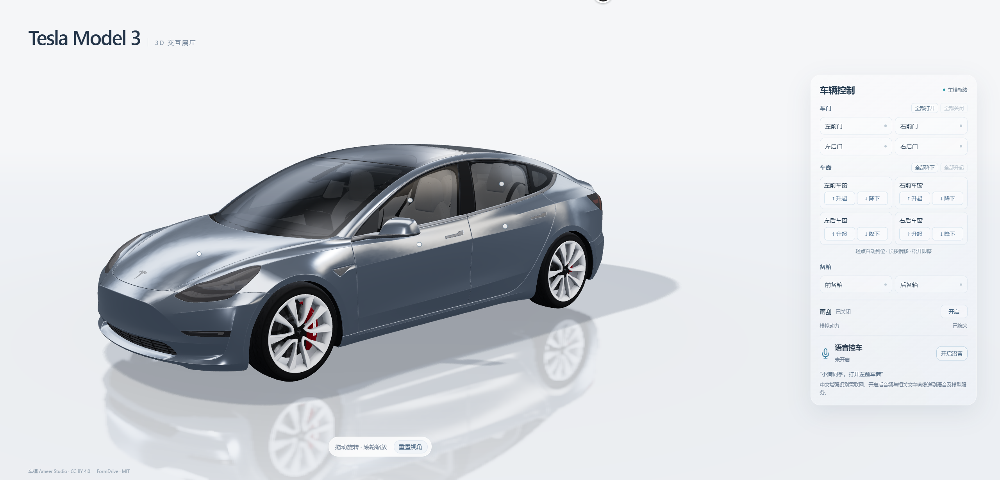

# 3DCar · Tesla Model 3 交互展厅

基于 FormDrive 车模的网页 Demo：自由观察车身，点击控制四门、四窗和前后备箱。本地完整版还支持「小满同学」唤醒、中文语音识别与大模型连续对话控车。

**[打开在线演示](https://houyanbin2002.github.io/3DCar/) · [演示视频](#演示视频) · [重点文档](#重点文档) · [本地运行](#本地运行)**

## 在线体验

[GitHub Pages 展示版](https://houyanbin2002.github.io/3DCar/) 可直接体验 3D 旋转、缩放、点击控车、车窗升降和雨刮。桌面 Chrome / Edge 优先，无需登录或安装软件。

线上版不部署语音识别或大模型接口，也不请求麦克风。完整语音功能保留在源码及本地完整版中，通过下方演示视频展示。每次合并到 main 后，由 [GitHub Actions](https://github.com/Houyanbin2002/3DCar/actions/workflows/pages.yml) 自动检查、构建和发布。

## 演示视频

> **视频位置已预留，待上传。**
>
> 这里将展示唤醒控车、模糊需求澄清、多轮对话和连续车窗调整。在线展厅右侧也有视频展示区域。

<!-- 上传视频后，可在这里粘贴 GitHub 附件视频地址，或添加观看链接。 -->

发布视频只需设置仓库变量 **VITE_DEMO_VIDEO_URL** 并重新运行 Pages 工作流：MP4 / WebM / OGG 地址可在展厅内播放，B 站等视频页面链接以观看入口展示。操作步骤见 [发布与视频配置](docs/deployment.md)。

## 当前功能

| 功能 | GitHub Pages | 本地完整版 |
| --- | --- | --- |
| 银色 Model 3、展厅光照、阴影与地面倒影 | 支持 | 支持 |
| 拖拽旋转、滚轮缩放、重置视角 | 支持 | 支持 |
| 四门、四窗、前后备箱独立控制与动画 | 支持 | 支持 |
| 车窗轻点自动到位、长按慢移、松开停止 | 支持 | 支持 |
| 全部门窗批量操作、雨刮启停 | 支持 | 支持 |
| 「小满同学」唤醒、中文实时语音识别 | 视频展示 | 支持，需配置接口 |
| 规则控车、多指令、25% / 50% 开窗 | 视频展示 | 支持 |
| 模型澄清、修改建议、上下文操作与相对调整 | 视频展示 | 支持，需配置接口 |
| 操作后 20 秒免唤醒、超时恢复等待唤醒 | 视频展示 | 支持 |
| 动力启停状态、工具回执和失败项重试 | 视频展示 | 支持 |

左右按车辆前进方向区分。动作只作用于网页车模，动力为演示状态。

## 怎么操作

- **观察车辆**：左键拖拽旋转，滚轮缩放，点击「重置视角」回到初始角度。
- **控制部件**：点击车身热点、可控表面或右侧按钮。车门与备箱点击切换，车窗使用「升起 / 降下」。
- **调整车窗**：轻点自动到位；长按缓慢移动，松开即停，部分开启时显示百分比。
- **本地语音**：配置接口后开启语音、允许麦克风，再说「小满同学」。

本地完整版示例：

| 说法 | 行为 |
| --- | --- |
| 小满同学，打开左前门，再打开后备箱 | 按顺序执行两项动作 |
| 小满同学，把左前车窗打开一点 | 左前窗到 25% 开度 |
| 所有车窗打开一半 | 免唤醒窗口内，四窗到 50% 开度 |
| 再低一点 | 沿用已明确窗位，基于当前开度继续调整 |
| 小满同学，车里有点闷热 | 模型先给建议，意图不明时继续澄清 |
| 帮我降下全部车窗吧 | 修改单窗建议，明确意图后直接降下四窗 |
| 那你帮我升起吧 | 结合最新上下文直接升窗，无需额外说「可以」 |
| 好了 / 结束 / 不用了 | 结束本轮对话，恢复等待唤醒 |

首次需要唤醒。每次语音动作完成后，20 秒内可直接继续说，下一次完成重新计时；模型正在澄清时保留 60 秒答复时间。

## 重点文档

| 文档 | 重点内容 |
| --- | --- |
| [需求与验收标准](3D仿真车模需求文档.md) | 功能范围、交互规则、验收场景 |
| [落地方案与项目架构](落地方案与项目架构.md) | 场景、车辆控制器、语音与模型接口边界 |
| [发布与视频配置](docs/deployment.md) | GitHub Pages、展示版与本地版、视频更新 |
| [语音模块规格](src/voice/SPEC.md) | 唤醒、连续操作、模型直接执行、取消与超时 |
| [工具扩展与执行反馈](src/voice/TOOLS.md) | 注册工具、参数验证、逐项回执、有界重试 |
| [服务端运行说明](server/README.md) | 本地 ASR / 大模型配置、密钥与接口契约 |
| [语音改进验证记录](docs/speech-verification.md) | 真实识别、千问及车模联动测试证据 |
| [车辆交互验证](dev/vehicle-interaction/README.md) | 部件动画、手势与浏览器验证方法 |
| [模块拆分与并行开发](模块拆分与并行开发.md) | 模块职责、分支分工、独立验收与合并约定 |

早期分支联调历史见 [合并与联调记录](docs/integration-verification.md)。

## 本地运行

使用 **Node.js 22.12+（22.x）**：

    npm ci
    npm run dev

按终端提示打开地址，默认 http://localhost:5173/。车模展示和点击控车无需后端。

完整语音另外安装并配置本地接口：

    npm --prefix server ci

1. 将 [前端配置示例](.env.example) 复制为 .env.local，设置公开的 VITE_INTENT_API_URL。
2. 将 [服务端配置示例](server/.env.example) 复制为 server/.env.local，填写服务端模型 Key。
3. 在 server 目录运行 npm run dev，默认端口 8787；前端配置的地址与后端端口需要对应。
4. 重启前端并授权麦克风。识别与模型需要网络，实际识别受设备、口音和噪声影响。

默认中文识别为 qwen-audio-3.1-asr-flash-message，模型理解为 qwen3.8-omni-flash。密钥只放在服务端，实际配置文件不进入仓库。详见 [服务端说明](server/README.md)。

## 验证与构建

    node --test dev/vehicle-interaction/controller.test.mjs
    node src/voice/tests/run.mjs
    npm --prefix server test
    npm run build

当前自动测试包含车辆控制器 13 项、语音 57 项、接口与配额 36 项。真实语音另有音频和浏览器联调记录，小样本结果不等同于任意环境的识别准确率。

Pages 按仓库子路径构建，并设置 **VITE_DEMO_MODE=showcase**；本地不设置该变量时保留完整语音入口。更多命令见 [部署说明](docs/deployment.md)。

## 车模来源与许可

- 车模：Ameer Studio 的 [Tesla 2018 Model 3](https://sketchfab.com/3d-models/tesla-2018-model-3-5ef9b845aaf44203b6d04e2c677e444f)，[CC BY 4.0](https://creativecommons.org/licenses/by/4.0/)。[车模署名](public/models/TESLA-LICENSE.md)。
- 上游项目：[FormDrive](https://github.com/nesdesignco/FormDrive)，复用 GLB、节点配置和部分动画思路，保留 [上游 MIT 许可](public/models/FORMDRIVE-LICENSE.md)。
- 本项目适配了车模材质、场景光照、控制面板、交互状态与语音流程。
