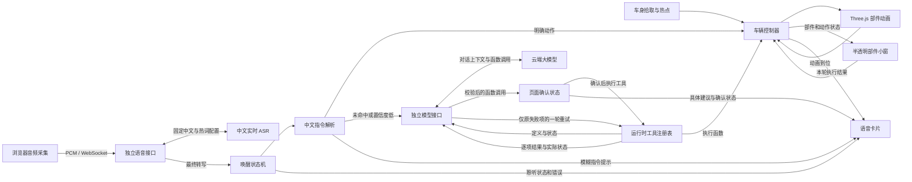

# 3D 仿真车模 Demo 落地方案与项目架构

| 项目 | 内容 |
| --- | --- |
| 文档版本 | v1.7（20 秒免唤醒、连续对话与中文实时 ASR） |
| 日期 | 2026-11-04 |
| 需求基线 | [3D 仿真车模交互 Demo 需求文档 v1.8](./3D仿真车模需求文档.md) |
| 技术路线 | 独立项目复用 FormDrive 的 Tesla Model 3 资产和部件动画逻辑 |
| 界面基线 | 全屏白色展厅、环境反射与地面倒影、车身热点、半透明部件小窗和语音卡片 |
| 发布目标 | GitHub Pages 项目站点与独立 HTTPS 模型接口，桌面 Chrome、Edge 为正式验收环境 |

## 1. 技术选型与复用边界

| 层级 | 选型 | 职责 |
| --- | --- | --- |
| 页面与构建 | Vite、React、TypeScript | 单页布局、控制小窗、加载与反馈、静态打包 |
| 3D 场景 | React Three Fiber、Three.js `WebGLRenderer` | 场景组织、车模加载、渲染循环、光照和阴影 |
| 车辆动画 | Three.js 节点变换、`MathUtils.damp`、R3F `useFrame` | 四门旋转、四窗升降、前后备箱开合 |
| 观察与点击 | Three.js `OrbitControls`、射线拾取 | 拖拽、缩放、部件命中与热点定位 |
| 语音 | Web Audio / AudioWorklet、千问中文实时 ASR、浏览器端规则、SpeechSynthesis | 16 kHz PCM 采集、后端 WebSocket 转写、唤醒、指令解析、播报和确认 |
| 模型接口 | 独立部署的 HTTPS Serverless 函数、千问 Function Calling | 接收当前转写、对话上下文及运行时工具结构，澄清需求并返回经校验的函数调用 |
| 发布 | GitHub Actions、GitHub Pages、Serverless 运行环境 | 静态站点和模型接口分别部署，GLB 随站点同源提供 |

锁定 FormDrive 上游提交 `e2f861630035385adacd1c5fcdeae5258557cce6` 作为首版复用基准。复用该提交的 `tesla-model-3-2018.glb`、`studioConfig.js` 中 Tesla 的部件参数，以及 `VehicleModel.jsx` 中的节点匹配、原始变换保存和窗玻璃遮罩逻辑。相机、光照、点击交互、悬浮小窗、车辆控制器和语音模块按本 Demo 组织。[上游版本](https://github.com/nesdesignco/FormDrive/tree/e2f861630035385adacd1c5fcdeae5258557cce6) · [部件配置](https://github.com/nesdesignco/FormDrive/blob/e2f861630035385adacd1c5fcdeae5258557cce6/src/config/studioConfig.js) · [车辆动画](https://github.com/nesdesignco/FormDrive/blob/e2f861630035385adacd1c5fcdeae5258557cce6/src/components/scene/VehicleModel.jsx)

已读取 GLB 元数据。文件为 glTF 2.0，约 **22.7 MB**，动画轨道数为 **0**，未声明必需压缩扩展。首版使用原始文件，通过 `GLTFLoader` 加载并以代码驱动动画。发布时保留模型作者 Ameer Studio、原始来源和 CC BY 4.0 许可链接，资产修改时记录改动。移植上游源码时保留对应 MIT 许可声明。[GLB 文件](https://github.com/nesdesignco/FormDrive/blob/e2f861630035385adacd1c5fcdeae5258557cce6/public/models/tesla-model-3-2018.glb) · [车模归属](https://github.com/nesdesignco/FormDrive/blob/e2f861630035385adacd1c5fcdeae5258557cce6/public/models/TESLA-LICENSE.md) · [上游源码许可](https://github.com/nesdesignco/FormDrive/blob/e2f861630035385adacd1c5fcdeae5258557cce6/LICENSE) · [CC BY 4.0](https://creativecommons.org/licenses/by/4.0/)

## 2. 模块划分与数据流



目标目录结构如下。公共契约已放入脚手架，各功能路径的分工见[模块拆分与并行开发](./模块拆分与并行开发.md)。

```text
3DCar/
├─ index.html
├─ package.json
├─ package-lock.json
├─ vite.config.ts
├─ public/models/
│  ├─ tesla-model-3-2018.glb
│  └─ TESLA-LICENSE.md
├─ src/
│  ├─ main.tsx
│  ├─ App.tsx
│  ├─ contracts/vehicle.ts   # 车辆、场景和语音共用的契约
│  ├─ scene/
│  │  ├─ Showroom.tsx          # 画布、相机、灯光、地面
│  │  ├─ TeslaModel.tsx        # GLB 加载、节点绑定、逐帧更新
│  │  ├─ PartHotspots.tsx      # 点击拾取与车身热点投影
│  │  └─ model3Parts.ts        # 部件节点、动作参数、热点锚点
│  ├─ vehicle/
│  │  └─ vehicleController.ts # 命令队列、目标状态、动作结果
│  ├─ voice/
│  │  ├─ useVoiceControl.ts   # 识别会话、唤醒、播报与确认状态
│  │  ├─ parseCommand.ts      # 本地指令解析与路由判定
│  │  ├─ intentClient.ts      # HTTP 传输和旧分类契约兼容
│  │  ├─ controlClient.ts     # 运行时工具请求与响应校验
│  │  ├─ toolRegistry.ts      # 工具注册、准备与逐项执行回执
│  │  └─ runToolCycle.ts      # 结果回传、失败项重试与最终汇总
│  └─ ui/
│     ├─ PartPanel.tsx
│     ├─ VoicePanel.tsx
│     └─ showroom.css
├─ shared/intent.ts            # 前后端共用的模型接口契约
├─ shared/control.ts           # 工具定义、调用、回执与重试约束
├─ server/                     # 模型接口，独立部署
│  └─ intent.ts                # 请求校验、限流与模型调用
└─ .github/workflows/pages.yml
```

**车辆控制器是界面状态的唯一来源。** 小窗和热点发送切换动作，语音发送明确的目标状态。控制器维护部件的稳定状态、目标状态和执行状态，场景负责每帧更新姿态，到位后回传完成。React 只接收执行开始、到位或失败等状态变化。

同一部件的请求由控制器串行处理。动画期间，手动入口显示「执行中」并暂时禁用，其他部件仍可操作。语音批次按文本顺序逐条执行，每条动作完成后再推进。一次「关闭所有车窗」属于一条动作，组内四扇窗可同时升起，全部到位才进入下一条。已到目标状态的指令直接反馈「已打开」或「已关闭」。

## 3. 车辆场景与部件动画

### 3.1 节点绑定

| 部件 | GLB 节点 | 动画依据 |
| --- | --- | --- |
| 左前门、左后门 | `door_lf_dummy`、`door_lr_dummy` | 绕各自局部 Z 轴，开启角分别为 −1.08、−1.02 rad |
| 右前门、右后门 | `door_rf_dummy`、`door_rr_dummy` | 绕各自局部 Z 轴，开启角分别为 +1.08、+1.02 rad |
| 左前窗、左后窗 | `door_lf_glass.0_0`、`door_lr_glass.0_0` | 按上游行程和玻璃包围盒计算下降距离 |
| 右前窗、右后窗 | `door_rf_glass.0_0`、`door_rr_glass.0_0` | 按上游行程和玻璃包围盒计算下降距离 |
| 前备箱、后备箱 | `bonnet_dummy`、`boot_dummy` | 绕各自局部 X 轴，开启角分别为 +0.58、−0.82 rad |

加载后校验 10 个节点是否能唯一匹配。按 GLB 原始名称及 Three.js 加载后的规范化名称定位，保留父子层级。以加载时的局部变换为闭合基准；门和箱盖在基准角上加开启量，窗玻璃的下降方向换算到车门局部空间。车门打开时，玻璃仍随门移动并可独立升降。[上游节点定义与行程](https://github.com/nesdesignco/FormDrive/blob/e2f861630035385adacd1c5fcdeae5258557cce6/src/config/studioConfig.js) · [GLTFLoader 文档](https://threejs.org/docs/pages/GLTFLoader.html)

每帧按实际时间差做阻尼插值，在进入误差阈值时将变换落到精确目标，再通知控制器动作完成。车窗下沉时同步处理玻璃显隐和透明材质，避免玻璃从门板穿出。引擎指令直接更新模拟运行状态并提供文案反馈。

### 3.2 观察、拾取与小窗

- `OrbitControls` 处理左键拖转和滚轮缩放，限制缩放距离和俯仰范围。记录按下期间指针离起点的最大位移，超过阈值即判为拖拽，轻点才进入拾取。[OrbitControls](https://threejs.org/docs/pages/OrbitControls.html)
- 射线取车模最近的可见表面，将命中的门板、玻璃或箱盖子网格映射到部件 ID。若最前方是不可交互的车身表面，结束拾取。热点以车身上的局部锚点投影到屏幕，遮挡时隐藏。[Raycaster](https://threejs.org/docs/pages/Raycaster.html)
- 车窗热点放在跟随车门的窗框位置，玻璃完全降下后依旧可点击。箱盖热点可随可见箱盖移动。右侧小窗按车门、车窗和备箱分组，始终提供对应部件的按钮与状态。四窗按方位排成 2×2，提供「全部降下」「全部升起」。
- 白色展厅由 3D 画布铺满。用环境反射塑造银色车漆，用柔光、地面倒影和阴影建立车身层次。部件和语音合并在右侧半透明小窗，使用 HTML/CSS 叠加在画布之上。控件区域接收点击，周围透明区域可拖动车模。[Three.js 环境光照](https://threejs.org/docs/pages/RoomEnvironment.html)

## 4. 语音状态机与指令执行

### 4.1 唤醒和本地规则

1. **开启。** 用户点击「开启语音」后授权麦克风，通过 Web Audio 和 AudioWorklet 采集 16 kHz、单声道、16-bit PCM，经独立 Worker 的 `GET /api/speech` WebSocket 转发到 `qwen-audio-3.1-asr-flash-message`。默认固定中文，配置「小满同学」、窗位和车辆部件热词，服务端保管 Key。收到上游 `task-started` 后才显示「等待唤醒」。浏览器原生 SpeechRecognition 适配器保留用于兼容测试，默认链路使用中文增强 ASR。[千问实时识别说明](https://help.aliyun.com/en/model-studio/real-time-speech-recognition-user-guide)
2. **唤醒。** 对转写做空白和标点归一化，在等待状态下匹配固定词「小满同学」。同段有指令时保留唤醒词之后的内容。单独唤醒时进入「聆听指令」，给用户 5 秒开始说话。权限、浏览器或在线识别服务异常时，在语音卡片上给出相应提示。
3. **收集。** 暂定用约 1 秒静默作为一轮的收尾窗口，最终值用真实试说调校。浏览器若把一轮话语分成多个识别结果，按结果序号追加已确认片段。语音开始事件或含指令的中间结果可确认用户已开始说话，动作只由本轮最终文本产生。5 秒限制的是开始说指令的时间，收尾窗口负责等待后续分句。
4. **判定与执行。** `routeCommand()` 按规则完整性标记 `high`、`low` 或 `unmatched`。完整匹配的动作直接执行。低置信度和未匹配片段进入 §4.2，例如「打开左前门，再打开」先执行第一项，再将第二项和当前状态送给模型追问。
5. **结束或恢复。** 执行完成、指令未识别或超时后，展示结果并回到等待唤醒。识别会话自然结束时，仅在用户仍开启语音且允许恢复的状态下重新开始。关闭语音时取消识别和本轮收集，丢弃过期回调，并撤销尚未下发的语音动作。权限、网络或识别服务错误时显示相应提示，手动控车可独立使用。[Web Speech API 规范](https://webaudio.github.io/web-speech-api/)

### 4.2 运行时工具与一次确认

1. **规则路由。** 每轮按片段顺序处理。完整匹配直接交给车辆控制器，其他片段携带当前工具结构和状态送给后端。置信级别由完整规则匹配判定。
2. **模型选择工具。** 通过千问的 `tools` 参数注入当前注册的函数与 Schema，接收 `tool_calls` 的名称和参数。`ToolRegistry.prepare()` 验证全部调用并生成待执行动作。工具执行结果用于页面反馈，目标不明确时模型直接追问。
3. **播报与确认。** 页面显示追问并通过 `SpeechSynthesis` 播报。播报前暂停识别，播报结束后重连；由输入适配器的 `onStart` 事件启动 15 秒确认窗口。连接过程不消耗回答时间。最终转写为「可以」「需要」「好的」时执行，「不用」「不可以」「取消」时撤销，无需再次唤醒。用户开始回答后最多等 10 秒获取最终结果；含糊答复重新提示。页面按钮保留为补充入口。[Web Speech API 规范](https://webaudio.github.io/web-speech-api/)
4. **执行或撤销。** 首版模型调用的车辆变更统一确认后执行，本地明确规则动作直接执行。新工具可声明只读且无需确认。一次回复最多 8 个函数调用，按顺序执行。取消、超时、关闭语音或重新唤醒时清除旧建议和剩余步骤。退出本轮时中止请求并忽略旧回调。
5. **扩展。** `ToolRegistry.register()` 登记定义、状态读取、确认策略和执行方法，返回注销方法。下次模型请求读取最新注册表。新增工具的接线示例见[工具扩展说明](./src/voice/TOOLS.md)。

### 4.3 工具结果与有界 ReAct

执行器为每条调用生成 `toolCallId`、`status`、`effect`、`message`，失败时增加错误码与重试资格，并尽量读取实际状态。同批仅允许独立动作，单项失败后继续处理其余独立项。`runToolCycle()` 将所有回执和原调用作为 `history` 发回接口，后端构造原 `assistant.tool_calls` 和逐条带 `tool_call_id` 的 `role: tool` 消息，再请模型判断。

自动重试上限为一轮，仅允许初次失败且可恢复的同名、同参数操作，必须使用新调用 ID。前后端均拦截重放成功项、换对象、改参数或超限重试。重试绑定原工具实例及已确认计划，注销工具后旧计划失效。结果不确定时，仅已声明幂等且读回状态的工具可以标记可重试。取消和不可恢复错误禁止重试。

重试后再回传结果并强制 `tool_choice: none` 生成最终说明；全部成功时同样反馈结果并禁止追加动作。包含初次规划最多请求模型 3 次，分别计入接口配额。复核超时或限流时保留执行结果，页面从回执计算最终数量。详细接入契约及错误示例见[工具扩展说明](./src/voice/TOOLS.md)。

## 5. 独立模型接口与部署边界

中文识别由同一 Worker 的 `/api/speech` 提供 WebSocket 代理，默认从 `VITE_INTENT_API_URL` 推导地址，也可单独配置 `VITE_SPEECH_API_URL`。线上使用 WSS。服务端只允许固定识别配置、受控大小的二进制 PCM、允许的 Origin；识别与模型请求使用独立配额桶，演示配置各为每客户端每分钟 20 次、全站每日 100 次。识别单会话最多 120 秒，结束后按当前状态重新连接，关闭语音即停止音轨及上游连接。Worker 显式设置 `binaryType = 'arraybuffer'` 后接收音频帧。[Workers WebSocket 二进制类型](https://developers.cloudflare.com/workers/runtime-apis/websockets/#binary-messages)

规则未命中后，状态机维持 `dialogue` 状态。`ControlRequest.dialogue` 携带最近最多 12 条交替的 user/assistant 消息，总计最多 6000 字符，每条最多 1000 字符；浏览器内存保存，后端逐请求校验后注入消息列表，不额外持久化。工具结果摘要纳入后续对话，工具上下文每次重新读取实际车辆状态。缺少对象或幅度时继续追问，短答按历史补全；尚在澄清时等待 60 秒，操作完成后等待 20 秒的后续指令。相对开窗转换为基于实际位置的绝对工具目标，原有重试仍只接受同参数原动作。

车窗规则将「一点」「一点点」「一条缝」解析为绝对开度 0.25，「一半」为 0.5，「完全」为 1，通过现有 `VehicleAction.openness`、`setWindowOpenness()` 驱动动画。明确窗位或所有车窗时直接执行；泛指「车窗打开一半」进入本地确认步骤，用户同意后执行四窗目标，不请求语言模型。`set_window_openness` 工具允许模型使用同一开度接口。部分开度在控制面板显示百分比。

所有语音动作完成后进入 20 秒的 `dialogue` 免唤醒窗口，包含规则动作。下一条仍规则优先，未命中则携带上一动作、执行摘要及当前状态进入模型。后续动作完成后重新计时，超时恢复等待唤醒而不关闭识别。模型尚在澄清时使用 60 秒答复窗口。两类等待由 `dialogueIdleMs` 区分，进入说话或执行阶段停止旧计时。

GitHub Pages 发布车模与前端。前端用 `VITE_INTENT_API_URL` 配置独立 HTTPS 接口地址。兜底模型选用阿里云 `qwen3.8-omni-flash`，完整模型地址、名称和 `MODEL_API_KEY` 由后端运行时配置。密钥本地保存在 Git 忽略的 env 文件，线上使用部署平台的 Secret。[GitHub Pages 托管说明](https://docs.github.com/en/pages/getting-started-with-github-pages/what-is-github-pages) · [Vite 环境变量说明](https://vite.dev/guide/env-and-mode#env-variables) · [服务端 Secret 配置示例](https://developers.cloudflare.com/workers/configuration/secrets/)

| 接口约定 | 说明 |
| --- | --- |
| `POST /api/intent` | 新链路接收 `text`、`tools`、`context`，结果回传时附带最多两轮 `history`，受 `shared/control.ts` 约束。旧的单字段文本请求继续支持原分类契约。 |
| 支持的响应 | 新链路返回 `toolCalls` 和 `reply`。工具调用含 `id`、`name`、`arguments`，由实际登记的执行函数处理。无工具调用时显示模型追问。 |
| 失败处理 | 输入不符合约定返回 4xx，限流返回 429，上游失败返回 5xx。前端设定有限等待时间，并将失败统一转为简短的具体指令提示。 |

- **请求与输出约束。** 校验请求格式、工具定义和参数结构。服务端与浏览器分别验证模型函数名称和实参。工具请求体上限 32 KiB、最多 16 个工具。原单字段分类请求保持 4 KiB 上限。
- **公开接口用量。** 服务端限制调用频率、请求大小、模型输出长度和总用量，并处理上游超时。浏览器跨域配置仅允许正式 Pages 的来源及显式配置的开发来源。限流与用量约束由服务端独立执行。

## 6. 实施顺序与验收

| 阶段 | 交付内容 | 验证方法 |
| --- | --- | --- |
| 1. 验证关键链路 | 加载原始 GLB，绑定左前门和左前窗；用 HTTPS 测试页验证中文唤醒、二次识别和模型接口连通性 | 检查开门时车窗能独立升降。用实际演示网络分别试桌面 Chrome、Edge，覆盖连着说、短暂停顿、重新唤醒，并验证「车里有点闷热」能得到受限意图结果。 |
| 2. 完成 3D 与点击 | 十个部件、白色展厅、自由观察、热点和悬浮面板 | 对照 A02–A03。重点检查拖拽误触、玻璃完全降下后的反向操作和车身两侧的热点遮挡。 |
| 3. 接通语音与反馈 | 唤醒状态机、指令解析、批次执行、模拟引擎状态 | 对照 A04–A10。用模拟转写覆盖无标点、多段结果、部分有效、超时和过期回调，再用真实麦克风验证识别体验。 |
| 4. 接入智能语音增强 | 模型接口、前端意图请求、播报与一次确认 | 对照 A11–A14。验证等待确认前无车辆动作、取消和超时、异常降级，以及旧请求迟到时无误执行。 |
| 5. 发布与收尾 | GitHub Pages 正式地址、独立模型接口、README、模型署名与主页入口 | 对照 A01、A15，并在正式地址复跑 A02–A14。验收公开访问、跨域调用、服务端密钥和限流。 |

构建时使用锁文件安装依赖。项目站点构建环境通过 `PAGES_BASE=/<仓库名>/` 设置 Vite `base`。GLB、贴图等资源引用遵循这个基路径，由 Actions 构建并发布 `dist/`。模型加载显示进度或等待提示，失败时提供重试。先以原始 GLB 测量真实网络下的冷启动，再决定是否需要压缩。若更换或压缩资产，重新验证节点命名、玻璃材质和全部部件动作。[Vite 的 GitHub Pages 部署指南](https://vite.dev/guide/static-deploy.html#github-pages)

发布验收以 v1.8 的 A01–A23 为准。A01–A10 覆盖基础交付，A11–A15 覆盖智能语音和独立接口，A16–A17 验证模型直接选择函数及运行时工具扩展，A18–A19 验证部分成功、失败项重试与取消，A20–A23 验证比例开窗、连续澄清、20 秒免唤醒与结束对话。实际车模与麦克风的联动在集成环境验证。
